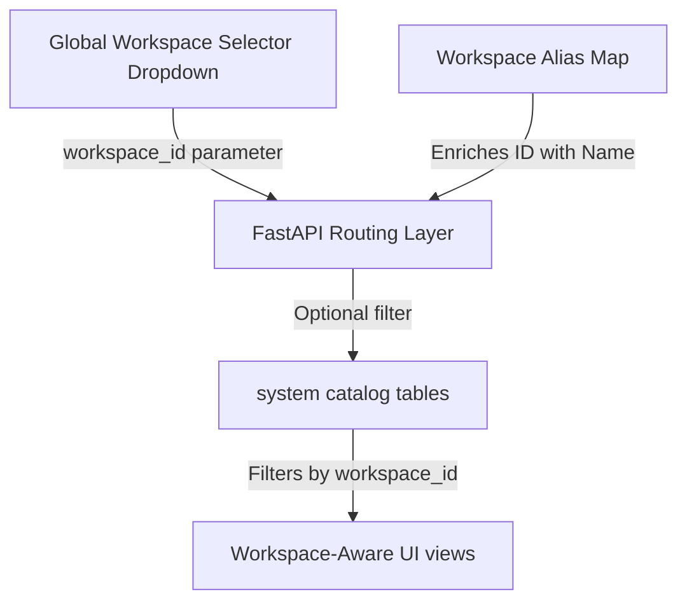

# 🌐 Databricks Multi-Workspace FinOps Architecture Guide

In a real-world enterprise environment, organizations rarely run a single Databricks workspace. Instead, they deploy multiple workspaces (e.g., separating environments like `dev`, `staging`, and `prod`, or structuring workspaces by business unit like `marketing`, `risk-analytics`, and `core-payments`).

Since all these workspaces are typically linked to a single **Unity Catalog Metastore** under a single **Databricks Account**, their logs are aggregated in the account-level `system` catalog. This guide explains how to design and modify **FinOps CoPilot** to support multi-workspace cost tracking, filtering, and lookup.

---

## 🗄️ The Data Foundation: How System Tables Track Workspaces

Every system table in the `system` catalog (such as billing logs and query histories) natively includes a `workspace_id` column.

| Table Name | Primary Columns | Workspace Column | Data Scope |
| :--- | :--- | :--- | :--- |
| `system.billing.usage` | `usage_date`, `sku_name`, `usage_quantity` | `workspace_id` (string) | Account-wide usage across all workspaces |
| `system.query.history` | `statement_text`, `read_bytes`, `executed_by` | `workspace_id` (string) | Query histories from all connected workspaces |
| `system.compute.clusters` | `cluster_id`, `node_type`, `num_workers` | `workspace_id` (string) | Compute configurations per workspace |
| `system.lakeflow.jobs` | `job_id`, `name`, `trigger` | `workspace_id` (string) | Jobs registered across all workspaces |

---

## 🏛️ Application Architecture Changes for Multi-Workspace Support

To support multiple workspaces across the three core areas (**Command Centre**, **Cost Lookup**, and **Run Intelligence**), we must implement a centralized routing and filtering mechanism:



### 1. Automated Workspace Name Lookup (`system.access.workspaces_latest`)
Instead of maintaining a manual config or JSON database of workspace name mapping, we can retrieve workspace names and metadata directly from the Databricks system tables. The specific metadata table is:

**`system.access.workspaces_latest`**

This table acts as a real-time account catalog containing active workspace IDs, names, and URLs.

#### Key Columns:
*   `workspace_id`: Unique identifier (string).
*   `workspace_name`: Human-readable workspace name (e.g., `"core-prod-us"`, `"dev-sandbox-eu"`).
*   `workspace_url`: The workspace's login URL.
*   `status`: Lifecycle status (e.g., `'RUNNING'`, `'PROVISIONING'`).

#### Example Join Query:
To attribute billing and DBU costs to actual workspace names dynamically:
```sql
SELECT 
  w.workspace_name,
  u.workspace_id,
  ROUND(SUM(u.usage_quantity * COALESCE(lp.pricing.default, 0.0)), 2) AS cost_usd
FROM system.billing.usage u
LEFT JOIN system.access.workspaces_latest w
  ON u.workspace_id = w.workspace_id
LEFT JOIN system.billing.list_prices lp
  ON u.sku_name = lp.sku_name
  AND u.usage_date >= lp.price_start_time
  AND (lp.price_end_time IS NULL OR u.usage_date <= lp.price_end_time)
WHERE u.usage_date >= CURRENT_DATE - INTERVAL 30 DAYS
GROUP BY 1, 2
ORDER BY cost_usd DESC
```

---

## 🛠️ Feature-Specific Implementations

### 1. Command Centre (Dashboards)
The dashboards (Overall, Interactive, Jobs, SQL Warehouses, DLT, etc.) currently query all data from the database. To enable multi-workspace filtering:

#### A. Frontend Selection:
*   Add a global workspace selector dropdown in the navigation header.
*   The dropdown choices are fetched from the API: `GET /api/workspaces` (which lists all workspace mappings + an "All Workspaces" option).
*   Selecting a workspace sets a global state (e.g., React Context) and appends the `workspace_id` query parameter to all dashboard requests: `/api/overall/kpis?workspace_id=459871239587`.

#### B. SQL Modification:
All queries in `data/queries/usage_overview.py` and other dashboards are updated to accept an optional `workspace_id` parameter:
```sql
-- Before
SELECT SUM(usage_quantity * default_price) FROM system.billing.usage
WHERE usage_date >= CURRENT_DATE - 30

-- After (Multi-Workspace Enabled)
SELECT 
  COALESCE(u.workspace_id, 'Shared') as workspace_id,
  SUM(u.usage_quantity * COALESCE(lp.pricing.default, 0.0)) as cost_usd
FROM system.billing.usage u
WHERE u.usage_date >= CURRENT_DATE - 30
  AND (:workspace_id IS NULL OR u.workspace_id = :workspace_id)
GROUP BY 1
```

---

### 2. Cost Lookup
When users search for a cluster, job, or warehouse in the **Cost Lookup** tool, they need to know which workspace holds that resource, and optionally filter by it.

#### A. Cross-Workspace Results:
If the user searches for `daily_etl_job` without a workspace filter, show matching jobs across all workspaces, labeled with their workspace names:

| Resource ID | Resource Name | Workspace Name | MTD Cost | Product |
| :--- | :--- | :--- | :--- | :--- |
| `1102` | `daily_etl_job` | **Prod-US-East** | $4,500.00 | Jobs |
| `1102` | `daily_etl_job` | **Dev-Sandbox** | $120.00 | Jobs |

#### B. Search Query Implementation (`cost_lookup.py`):
Update the search queries to include the `workspace_id` and join the cluster/job metadata accordingly:
```sql
SELECT
  u.usage_metadata.job_id AS job_id,
  COALESCE(MAX(j.name), u.usage_metadata.job_id) AS job_name,
  u.workspace_id AS workspace_id,
  ROUND(SUM(u.usage_quantity * COALESCE(lp.pricing.default, 0.0)), 2) AS total_cost_usd
FROM system.billing.usage u
LEFT JOIN system.lakeflow.jobs j
  ON u.usage_metadata.job_id = j.job_id
  AND u.workspace_id = j.workspace_id  -- Ensure metadata joins in the correct workspace
WHERE u.usage_date >= CURRENT_DATE - 30
  AND (:workspace_id IS NULL OR u.workspace_id = :workspace_id)
  AND (LOWER(u.usage_metadata.job_id) LIKE LOWER('%:search%') OR LOWER(j.name) LIKE LOWER('%:search%'))
GROUP BY u.usage_metadata.job_id, u.workspace_id
```

---

### 3. Run Intelligence
Run Intelligence analyzes a single run of a job or a DLT pipeline update. 

#### A. Unique Identification:
A `run_id` is globally unique within a Databricks Account, but to avoid conflicts and verify access permission, every API call to retrieve execution logs and performance metrics should supply both the `workspace_id` and the `run_id`:
```http
GET /api/run-intelligence/analyze?workspace_id=459871239587&run_id=run_99482_abc
```

#### B. Workspace-Specific Pricing & Environment Context:
When the AI parses log statistics (e.g., driver node size, executor node type, and DBU usage) to give right-sizing recommendations:
*   The system queries `system.compute.clusters` filtered by the target `workspace_id` to understand what **Cluster Policies** are active in that specific workspace.
*   If the workspace is located in a specific region (e.g., `eu-west-1` instead of `us-east-1`), the AI advisor queries `system.billing.list_prices` for that region to ensure savings projections match the local DBR/instance pricing rules of that specific workspace.
*   This prevents suggesting node types that are not approved in that workspace's active cluster policy.

---

## 🧭 UX & Search Pattern Evaluation: Hybrid Input Strategy

### The Strategy:
1.  **Cost Lookup Workspace Input**: A dropdown displaying `Workspace Name (Workspace ID)` with an option for manual text entry of the name or ID.
2.  **Run Intelligence Job Selection**: Toggling between selecting a Job from a dropdown or inputting the Job Name/ID manually. Case-insensitive matching (`LOWER()`) is enforced on names.
3.  **Run Selection**: Toggling between selecting from a dropdown of recent runs or entering a manual `run_id` string.
4.  **Pipeline Selection**: Same hybrid input structure as Jobs.

### Architectural Fit for Medium & Complex Databricks Environments:
This hybrid approach is **highly recommended** and represents a best practice for enterprise scale. 

#### Why strict dropdowns fail at scale:
*   **API Performance Limits**: In a medium/large environment, there can be thousands of jobs and millions of runs. Loading these into a standard select box will trigger browser lag and timeout errors.
*   **Pasting Workflow**: SREs and Data Engineers usually copy a specific `run_id` or `job_id` from a Slack cost anomaly alert, Databricks dashboard, or logs file. They need to paste it directly into the FinOps tool rather than searching a menu.

#### Recommended Implementation Tips:
*   **Standardized Resource Disambiguation Flow (Jobs, Pipelines, Clusters, Warehouses)**: In Databricks, names are not unique for **any** compute or workflow resource—multiple jobs, DLT pipelines, clusters, or SQL warehouses can share identical names (e.g., two teams running their own separate `"dev-cluster"` or `"daily_etl"` inside the same workspace). 
    To maintain a uniform UX and simple frontend code paths, the search input for *all* resource lookup tools should follow a single, generic selection workflow:
    1.  **Uniform Search Result Output**: Whether the search input matches exactly one resource (by direct ID or name) or matches multiple resources (by name), **always display the matching result list to the user first**.
    2.  **Metadata Indicators**: Show differentiating columns in the result table (e.g. Workspace ID, Owner, Resource Type, ID, Created Date) to help the user verify they have the right target.
    3.  **Explicit User Activation**: The user must explicitly click a row/button to "Confirm and Proceed" (e.g., to load run history or calculate costs).
    This design makes the UI extremely predictable, creates a single generic code path, and handles non-unique name environments perfectly.
*   **Scoped Dropdowns & Manual Overrides**: Since the user selects the `workspace_id` first and then the `job_id` / `pipeline_id`, querying runs is scoped to a specific job in a specific workspace. Therefore, the "runs" dropdown is lightweight and will not experience scaling issues. However, the manual text field for `run_id` / `update_id` remains critical for:
    1.  **Pasting UUIDs**: For DLT pipelines, executions use random UUIDs (`update_id`). Engineers debugging an alert will copy this UUID from external logs and want to paste it directly to load the run.
    2.  **Historical Analysis**: Accessing run logs beyond the dropdown's page limit (e.g., runs from 30+ days ago that are stored in the database but omitted from the active dropdown list).
*   **Case Insensitivity**: Standardize all query conditions in database schemas using `LOWER(name) = LOWER(:search)` to ensure casing variations do not break matches.
